


 

## 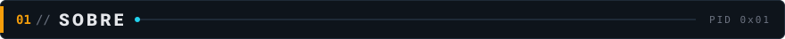

  

## 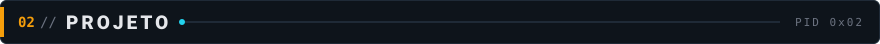

  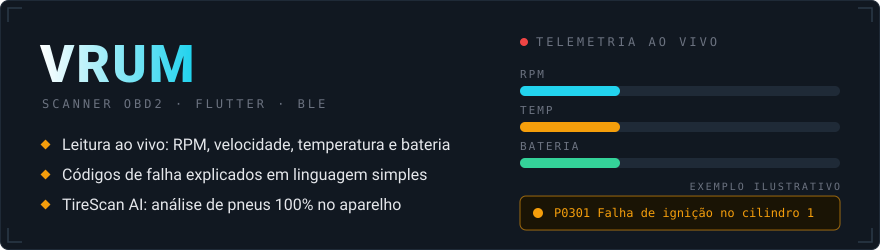

Conecta em adaptadores **OBD2 Bluetooth (ELM327/UScan)** e mostra o que está acontecendo com o carro em tempo real. O **TireScan AI** (em desenvolvimento) usa uma rede MobileNetV2 convertida para TFLite e processa tudo **localmente**, sem enviar dados para a nuvem.

**Stack:** Flutter · Dart · BLE (`flutter_blue_plus`) · TFLite · SQLite · Git/GitHub · 🌐 [vrumoficial.com.br](https://vrumoficial.com.br)

## 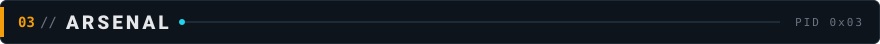

  

◆ **MOBILE** 
<kbd>Flutter</kbd> <kbd>Dart</kbd> <kbd>Android Studio</kbd> <kbd>BLE</kbd> <kbd>TFLite</kbd>

◆ **WEB** 
<kbd>HTML</kbd> <kbd>CSS</kbd> <kbd>JavaScript</kbd> <kbd>TypeScript</kbd>

◆ **BACK-END E LINGUAGENS** 
<kbd>Node.js</kbd> <kbd>Python</kbd> <kbd>C</kbd> <kbd>C++</kbd> <kbd>Java</kbd>

◆ **EM TREINAMENTO** 
<kbd>PostgreSQL</kbd> <kbd>Prisma</kbd> <kbd>JWT</kbd> <kbd>Docker</kbd>

◆ **FERRAMENTAS** 
<kbd>Git</kbd> <kbd>GitHub</kbd> <kbd>Linux</kbd> <kbd>SQLite</kbd> <kbd>VS Code</kbd>

## 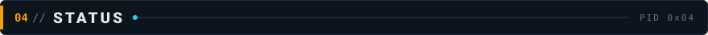

  
  

## 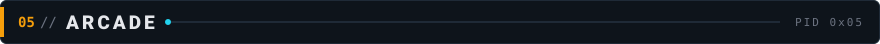

Cada contribuição, uma casinha a menos para a cobrinha. Meu histórico em modo jogo.

  

## 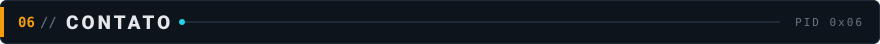

<em>Projetos web, mobile, automações ou uma boa conversa sobre carros e código.</em>

<a href="https://www.linkedin.com/in/Pedro-Lucas-Lopes-Monteiro/">LinkedIn</a> ·
<a href="https://vrumoficial.com.br">Vrum</a> ·
<a href="mailto:pedrolucaslopesmonteiro43@gmail.com">E-mail</a> ·
<a href="https://www.instagram.com/pedro.lc_/">Instagram</a>

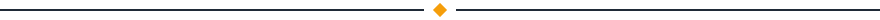

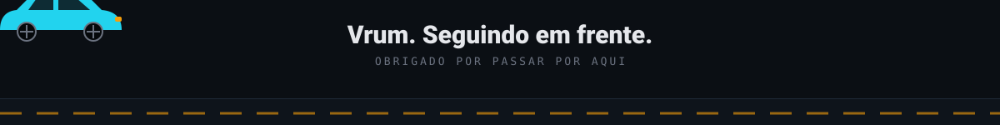

Créditos

Banners, títulos e cartões gerados com `profile/gen_assets.py`. Ícones de tecnologia: [Skill Icons](https://skillicons.dev/). Badges: [Shields.io](https://shields.io/). Estatísticas: [github-readme-stats](https://github.com/anuraghazra/github-readme-stats). Animação de contribuições: [Platane/snk](https://github.com/Platane/snk).

